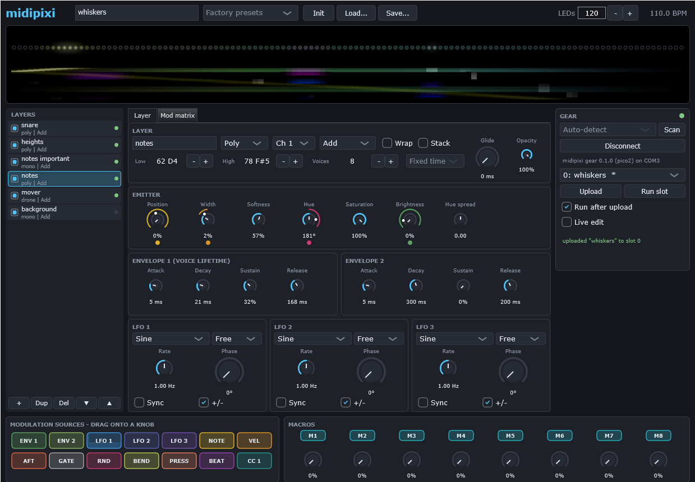

# midipixi

**A MIDI-driven LED strip visual effects engine — design light like you design sound.**

midipixi lets musicians and lighting artists drive LED-strip installations with
real-time MIDI from their DAW. It's built for live performers (live loopers,
electronic sets) playing smaller venues lit by LED strips.

If you can build a synth patch, you can build a midipixi preset: emitters
instead of oscillators, ADSRs and LFOs, MIDI CCs and macros wired through a
modulation matrix, layers blended like stacked sounds.



| Component | What it is |
|---|---|
| **midipixi gear** | A Raspberry Pi Pico 2 that plugs into USB, shows up as a MIDI device and drives WS2812 (NeoPixel) strips. No UI; presets are uploaded over USB serial and selected with MIDI Program Change. |
| **midipixi VST** | A VST3 "instrument" that shows an LED-strip simulator instead of making sound. It's the preset editor for the gear, and also runs as a standalone app. |
| **midipixi core** | The shared C++ engine both of them run, so the simulator matches the hardware. |

See [docs/ARCHITECTURE.md](docs/ARCHITECTURE.md) for the design,
[docs/PRESET_FORMAT.md](docs/PRESET_FORMAT.md) for the preset JSON and
[docs/PROTOCOL.md](docs/PROTOCOL.md) for the gear's USB serial protocol.

## Building (Windows)

Requirements: Visual Studio 2022 or 2026 with the C++ desktop tools, CMake ≥ 3.22, Ninja, git.
For the gear firmware: [Arm GNU toolchain](https://developer.arm.com/downloads/-/arm-gnu-toolchain-downloads)
(arm-none-eabi) and [pico-sdk 2.x](https://github.com/raspberrypi/pico-sdk)
with the `lib/tinyusb` submodule. Put them in `.tools/arm-gnu-toolchain` and
`.tools/pico-sdk`, or set `PICO_SDK_PATH` and put the toolchain on `PATH`.

`scripts\dev.cmd` runs any command inside a Visual Studio developer environment:

```bat
scripts\dev.cmd cmake --preset desktop
scripts\dev.cmd cmake --build --preset desktop
scripts\dev.cmd ctest --preset desktop
```

With several Visual Studio versions installed, `dev.cmd` uses the one (and the
MSVC toolset) a build folder was configured with, and the newest one for a new
or `--fresh` configure. Set `MPX_VS` to a major version (`17` = 2022,
`18` = 2026) or an installation folder to choose. To move a build folder to
another version, configure it again: `scripts\dev.cmd cmake --preset desktop --fresh`.

| Preset | Builds |
|---|---|
| `desktop` | core, tests, `mpx-cli`, VST3 + standalone (downloads JUCE on first configure) |
| `core-only` | core, tests, `mpx-cli` |
| `pico2` | gear firmware for Pico 2 → `build/pico2/gear/midipixi_gear.uf2` |
| `pico` | gear firmware for Pico 1 (RP2040) |

## Using the VST

Load **midipixi** as an instrument on a MIDI track. It makes no sound: the
window shows the LED strip simulator, which follows the track's MIDI.

- **Layers** (left): the stack of effects. The top of the list renders last.
  The checkbox mutes a layer.
- **Layer tab**: trigger mode and key zone, blend mode, emitter (the light
  shape), two envelopes and three LFOs.
- **Modulation**: drag a chip from *Modulation sources* (or a macro's `M1`…`M8`
  chip) onto any knob. A coloured ring shows the modulation range, and a white
  dot shows the live value. The small dots under a knob are the modulation
  amounts: drag them up/down, double-click to remove, right-click for options.
  The *Mod matrix* tab lists every row.
- **Macros** follow MIDI CC 20–27, so DAW automation reaches the gear too.
- **Gear** (right): connect, upload the preset to a slot, run a slot, or turn on
  *Live edit* to stream every change to the hardware.

## Command line

```bat
mpx-cli render presets\laser.json --demo set -o laser.png   :: waterfall image, no hardware needed
mpx-cli upload 6 my-preset.json --select
mpx-cli info
```

## Status

| Part | State |
|---|---|
| core engine, preset format, protocol | complete. Unit tests in `core/tests` (run in CI) |
| gear firmware | builds for Pico 2 and Pico 1. Not yet tested on hardware |
| VST3 / standalone | builds on Windows. Not yet tested in a DAW |
| macOS / Linux plugin builds, AU, CLAP, 2D panels | later |

## License

AGPL-3.0-or-later. See [LICENSE](LICENSE).
